# Awesome Enterprise Customer Support 🌟

  

  
  
  
  
  
  
  

  <strong>Curated Directory of Enterprise Customer Support Software, Self-Hosted Helpdesks, SLA Management Platforms & AI Ticketing Systems</strong>

---

## 📖 Introduction & Overview

Welcome to **Awesome Enterprise Customer Support**! 🎯 This curated registry tracks industry-standard **enterprise SaaS platforms** and production-grade **open-source helpdesk repositories**. 

Whether you are scaling high-volume omnichannel customer service operations with stringent Service Level Agreements (SLAs), integrating conversational AI agents with complex corporate CRMs, or seeking full data sovereignty with a self-hosted open-source support system (compliant with GDPR, HIPAA, or SOC 2), this guide delivers accurate pricing benchmarks, technical trade-offs, and verified architectural architectures. 🛡️✨

---

## 📑 Table of Contents

- [📊 Sector Overview & Market Dynamics](#-sector-overview--market-dynamics)
- [🏢 SaaS/Hosted Enterprise Platforms](#-saashosted-enterprise-platforms)
- [🔓 Open-Source GitHub Projects](#-open-source-github-projects)
- [🤝 How to Contribute](#-how-to-contribute)
- [💖 Support & Sponsor](#-support--sponsor)
- [📈 Star History](#-star-history)
- [⚖️ Disclaimer & Compliance](#️-disclaimer--compliance)

---

## 📊 Sector Overview & Market Dynamics

The global customer service software market is estimated at **$11B–$15B** (with the broader customer self-service, omnichannel contact center, and conversational AI segment surpassing **$20B–$26B**), expanding at an **11%–20% CAGR** propelled by enterprise generative AI automation and deep cross-department workflow routing. 

The industry displays a distinct **hybrid market structure**:
- **Enterprise Concentration (Top Tier)**: High-end enterprise accounts are heavily concentrated around powerhouse platforms (**Microsoft Dynamics 365, Oracle CX, Salesforce Service Cloud, SAP, ServiceNow**) that offer multi-suite lock-in, global compliance, and unified ERP/CRM architectures.
- **Dynamic Fragmentation (Mid-Market & Open-Source)**: The SMB, mid-market, and self-hosted tiers are **moderately-to-highly fragmented**. Agile commercial vendors (**Zendesk, Freshdesk**) and self-hosted open-source champions (**Chatwoot, UVdesk, Zammad, FreeScout, Frappe**) provide deep customization and data sovereignty, ensuring no single winner-take-all monopoly exists across customer experience tech stacks. 🌐🚀

---

## 🏢 SaaS/Hosted Enterprise Platforms

*Ranked in descending order of parent company size, market valuation, and enterprise scale:* 💼

| Platform | Company Size (Market Cap / Valuation / Revenue) | Starting Tier Pricing | Free Tier / Trial Limit | Key Features & Enterprise Fit |
|---|---|---|---|---|
| **Microsoft Dynamics 365 Customer Service** | ~$3.1T Market Cap (Microsoft) | Customer Service Professional: **$50/user/month** (annual commitment); Enterprise at **$105/user/month**; Premium at **$195/user/month**; Attach license at **$20/user/month** | **30-day free trial**; includes sample data and core testing access for up to 25 users | 🏢 Best for Microsoft 365 & Teams-centric enterprises wanting unified routing, Copilot AI agents, and deep Power Platform automation. |
| **Oracle CX Service** | ~$370B Market Cap (Oracle) | RightNow Standard Dynamic Agent Desktop: **$110/user/month**; Enterprise Desktop: **$140/user/month** | **30-day free trial** via Oracle Cloud Trial with **$300 cloud credits** (guided demo required for full enterprise CX instance) | ☁️ Best for Oracle Fusion & ERP ecosystems needing integrated omnichannel service centers, knowledge routing, and field management. |
| **Salesforce Service Cloud** | ~$280B Market Cap (Salesforce) | Starter Suite: **$25/user/month**; Pro Suite: **$100/user/month**; Enterprise: **$165/user/month**; Unlimited: **$330/user/month** | **30-day free trial**; complete sandbox with sample customer data, guided workflows, and Einstein AI evaluation | ⚡ Best for global enterprises invested in Salesforce CRM demanding intricate omnichannel case handling and Agentforce AI workflows. |
| **SAP Service Cloud** | ~$260B Market Cap (SAP) | Standard CX service modules starting at **~$60–$130/user/month** (enterprise quote based on seat tier & volume) | **30-day free trial**; pre-configured sandbox featuring sample service workflows and Joule AI assistant access | 🔄 Best for SAP-centric organizations requiring end-to-end integration with SAP S/4HANA ERP, master data records, and field logistics. |
| **ServiceNow CSM** | ~$200B Market Cap (ServiceNow) | Customer Service Management fulfiller seats start at **~$130–$200/fulfiller/month** (standard annual subscription) | **Personal Developer Instance (PDI)** free indefinitely with active use (hibernates on inactivity; requires periodic login); formal sales sandbox on request | 🛠️ Best for large enterprises requiring customer support deeply linked with IT Service Management (ITSM), CMDB, and multi-department case resolution. |
| **Atlassian Cloud Enterprise Support (Jira Service Management)** | ~$45B Market Cap (Atlassian) | **Free plan: $0** (up to 3 agents); Standard: **$20–$25/agent/month**; Premium: **$51–$57/agent/month**; Enterprise: custom quote | **Free forever plan for up to 3 agents** (includes request queues and community support) or a **7-day free trial** of Standard/Premium tiers | 🎯 Best for engineering, DevOps, and IT operations teams already utilizing Jira seeking collaborative incident management and asset tracking. |
| **Zendesk Enterprise** | ~$10.2B Valuation (Acquired by Hellman & Friedman / Permira) | Support Team starting at **$19/agent/month**; Suite Professional at **$115/agent/month**; Suite Enterprise quote-only; Advanced AI add-on at **$50/agent/month** | **14-day free trial**; unrestricted access to full omnichannel ticketing suite, help center builder, and AI routing sandbox | 🌟 Best for mid-market to enterprise support organizations seeking an expansive app ecosystem (1,500+ integrations) and mature routing logic. |
| **Pegasystems** | ~$8B Market Cap (Pegasystems) | Case Management starting at **$97/user/month**; Enterprise tier at **$165/user/month**; Digital Engagement at **$260–$300/user/month** (or **$0.47–$1.26/case**) | **30-day free trial** (Pega Platform Community Edition sandbox, extendable by 15 days, 1 active environment per account) | 🤖 Best for organizations with mission-critical process automation, Next-Best-Action decision algorithms, and high-volume case orchestration. |
| **Freshdesk Enterprise** | ~$3.9B Market Cap (Freshworks) | Growth: **$19/agent/month** (billed annually) or **$15/agent/month**; Pro: **$55/agent/month**; Enterprise: **$89/agent/month**; Freddy Copilot at **$29/agent/month** | **Free forever plan for up to 2 agents** (or 14-day free trial of Pro/Enterprise tiers with full feature access) | 💡 Best for rapid setup, intuitive agent experiences, and cost-effective multichannel ticketing without heavyweight enterprise overhead. |
| **Khoros** | ~$250M+ Annual Revenue / Acquired by IgniteTech | Enterprise annual contracts starting at **~$50,000–$165,000/year** (median ACV ~$164,649/yr; implementation $10k–$100k+) | **No self-service free trial**; bespoke guided demo and sales-governed Proof of Concept (PoC) sandbox available upon request | 📱 Best for consumer brands managing massive social customer care volumes, brand communities, and cross-social escalation channels. |

---

## 🔓 Open-Source GitHub Projects

*Ranked in descending order of GitHub community stars:* ⭐

### 1. [Chatwoot](https://github.com/chatwoot/chatwoot)  💬🔥
- **Overview**: An open-source, omni-channel customer engagement platform built as an alternative to Intercom, Zendesk, and Salesforce Service Cloud.
- **Key Features**: Live chat widget, shared inbox, email support, WhatsApp, Facebook Messenger, Instagram, and Telegram integrations; custom webhooks, agent capacity rules, and mobile apps.
- **Tech Stack**: Ruby on Rails, Vue.js, PostgreSQL, Redis.
- **Deployment**: Docker Compose, Helm chart for Kubernetes, Linux VM, or Chatwoot Cloud.
- **Best For**: Companies wanting a modern, real-time omnichannel inbox with comprehensive chat widget capabilities and third-party bot integrations.

---

### 2. [UVdesk Community](https://github.com/uvdesk/community-skeleton)  📬🛡️
- **Overview**: A full-featured, enterprise-ready PHP-based open-source helpdesk system designed to streamline customer ticket management and team collaboration.
- **Key Features**: Unlimited agents, teams, mailboxes, and tickets; customer knowledge base portal, custom ticket fields, automated workflows, and email-to-ticket conversion.
- **Tech Stack**: PHP (Symfony framework), MySQL/MariaDB.
- **Deployment**: Traditional LAMP/LEMP stacks, Docker, or UVdesk hosted cloud.
- **Best For**: Businesses seeking a customizable PHP/Symfony ticketing backend that integrates smoothly into existing eCommerce platforms (Magento, WooCommerce, PrestaShop).

---

### 3. [Papercups](https://github.com/papercups-io/papercups)  ⚡📦
- **Overview**: Open-source live customer messaging software built for web and mobile apps, designed as a lightweight alternative to Intercom and Drift.
- **Key Features**: Customizable React chat widget, Slack integration (reply to customers directly from Slack channels), email forwarding, and clean REST APIs.
- **Tech Stack**: Elixir, Phoenix Framework, React, PostgreSQL.
- **Deployment**: Docker Compose, Heroku one-click deploy, AWS ECS.
- **Best For**: Developer-first teams and SaaS startups wanting instant Slack-to-customer conversation sync with embeddable React widgets.

---

### 4. [Zammad](https://github.com/zammad/zammad)  🌟🖥️
- **Overview**: A web-based open-source customer support and helpdesk system featuring one of the cleanest, fastest UIs in the open-source ecosystem.
- **Key Features**: Email, web forms, live chat, SMS, Telegram, Facebook, and WhatsApp channels; SAML 2.0, OpenID Connect, and Microsoft 365 SSO included in the free code; read-only admin audit logs, SLA management, and built-in migration wizards for Zendesk and Freshdesk.
- **Tech Stack**: Ruby 3.4, Rails 8, Vue.js, PostgreSQL, Elasticsearch.
- **Deployment**: Docker Compose, RPM/DEB native packages, or Zammad Cloud.
- **Best For**: Support teams looking for a modern UI with corporate SSO, audit logs, and zero per-agent license costs.

---

### 5. [FreeScout](https://github.com/freescout-help-desk/freescout)  🕊️⚡
- **Overview**: A lightweight, self-hosted helpdesk and shared inbox application engineered as a free, self-hosted alternative to Help Scout and Zendesk.
- **Key Features**: Zero limitations on user accounts, tickets, or shared mailboxes; 100% mobile-friendly responsive layout, multi-language support (30+ locales), conversation collision detection, open tracking, and native iOS/Android mobile apps.
- **Tech Stack**: PHP 8.x (Laravel), MySQL/MariaDB.
- **Deployment**: Runs on minimal VPS infrastructure (1–2 GB RAM), Docker, shared hosting, or one-click installers.
- **Best For**: Lean teams needing an email-first shared inbox with minimal server resource consumption and zero recurring seat costs.

---

### 6. [Chaskiq](https://github.com/chaskiq/chaskiq)  💬🚀
- **Overview**: A full-featured conversational marketing, customer support, and engagement platform designed as an alternative to Intercom, Drift, and Crisp.
- **Key Features**: Conversational chatbots, in-app messaging, email campaign automations, video calling, customizable live chat messenger, and integrations with WhatsApp, Twitter, and Slack.
- **Tech Stack**: Ruby on Rails, React, PostgreSQL, Redis.
- **Deployment**: Docker, Kubernetes, Heroku.
- **Best For**: Growth and support teams wanting an integrated messaging platform combining outbound onboarding tours, live chat, and automated marketing flows.

---

### 7. [Frappe Helpdesk](https://github.com/frappe/helpdesk)  ☕📋
- **Overview**: A streamlined, modern open-source customer service and ticketing solution built on the robust Frappe Python framework.
- **Key Features**: Unlimited agents, business hours SLA management, automatic ticket routing, customer self-service portal, knowledge base, and bidirectional synchronization with ERPNext records.
- **Tech Stack**: Python, Vue 3, Frappe Framework, MariaDB, Redis.
- **Deployment**: Self-hosted via Frappe Bench, Docker, or Frappe Cloud ($5/month).
- **Best For**: Organizations running ERPNext or the Frappe framework desiring a frictionless, native service desk with zero license tiers.

---

### 8. [Peppermint](https://github.com/Peppermint-Lab/peppermint)  🍃🎯
- **Overview**: A fresh, lightweight open-source issue management and customer ticket system created as a minimalist alternative to Zendesk and Jira Service Management.
- **Key Features**: Ticket triage, tags, priority assignment, canned responses, markdown editor, user roles, email alerting, and responsive mobile-ready interface.
- **Tech Stack**: Node.js, Express, React, MongoDB.
- **Deployment**: Docker Compose, Node.js manual deploy.
- **Best For**: Startups, IT departments, and small businesses wanting a hassle-free, modern Node/React ticket desk without legacy configuration bloat.

---

### 9. [Live Helper Chat](https://github.com/LiveHelperChat/livehelperchat)  📞🤖
- **Overview**: A veteran, battle-tested open-source live support and chat system featuring native bot builders, voice/video calling, and screen sharing.
- **Key Features**: Live web chat, proactive invitations, co-browsing, Telegram, Twilio WhatsApp, and Facebook Messenger support; visual bot builder, desktop notifications, and mobile applications.
- **Tech Stack**: PHP, MySQL/MariaDB, Node.js (for real-time socket cluster).
- **Deployment**: Docker, LAMP/LEMP stack, Kubernetes.
- **Best For**: High-traffic contact centers requiring advanced live chat widgets, visual conversational bots, and integrated voice/video calling.

---

### 10. [Request Tracker (RT)](https://github.com/bestpractical/rt)  🛡️🗂️
- **Overview**: The gold standard in enterprise-grade open-source issue tracking, workflow coordination, and service desk management, trusted by corporations and academic institutions worldwide for decades.
- **Key Features**: Unrivaled granular per-queue, per-role permissions; built-in enterprise asset management, REST 2.0 API, PGP/S/MIME email encryption, and customizable ticket lifecycle workflows.
- **Tech Stack**: Perl, Apache/FastCGI, MySQL/MariaDB, PostgreSQL, Oracle.
- **Deployment**: Linux source package, custom container configurations.
- **Best For**: IT, DevOps, and operations organizations demanding strict security permissions, verifiable audit trails, and multi-team queue segregation.

---

### 11. [OTOBO](https://github.com/RotherOSS/otobo)  🦉💼
- **Overview**: The premier maintained open-source fork of OTRS, purpose-built for comprehensive Customer Service, Help Desk, and IT Service Management (ITSM).
- **Key Features**: Free downloadable ITSM packages (CMDB, Change Management, Incident Management); customer self-service portal, flexible SLA definitions, OpenID Connect / LDAP integration, and RESTful APIs.
- **Tech Stack**: Perl, Apache/Nginx, MariaDB, MySQL, PostgreSQL, Oracle.
- **Deployment**: Self-hosted Docker Compose or Linux package installation.
- **Best For**: IT service desks and enterprise organizations requiring rigorous ITIL-aligned processes without expensive commercial licensing.

---

### 12. [Helpdock](https://github.com/Docker-Hunterpedia/Helpdock)  🔒🧭
- **Overview**: A security-hardened, multi-brand open-source customer support platform equipped with grounded AI and enterprise authentication.
- **Key Features**: Ticketing, help center, and chat widget in one image; multi-brand tenancy with row-level security; SAML 2.0 and OIDC SSO; verified OWASP ASVS 4.0.3 Level 2 alignment and Cosign-signed images with CycloneDX SBOMs.
- **Tech Stack**: Docker, Go/Node backend, PostgreSQL, S3-compatible object storage.
- **Deployment**: Docker Compose (lightweight requirement: 2 vCPU, 4 GB RAM).
- **Best For**: Security-conscious organizations and compliance-heavy sectors requiring verifiable software bill of materials (SBOM) and multi-brand customer support.

---

## 🤝 How to Contribute

Contributions, bug reports, and updates are warmly welcomed! 🎉

1. 🍴 **Fork** this repository.
2. 🌿 Create a feature branch: `git checkout -b feature/new-support-tool`
3. ✍️ Add or update entries in `README.md` following the established formatting guidelines:
   - Provide verified starting tier pricing and accurate free tier/trial limits.
   - Include the official repository link and stars badge for open-source tools.
4. 🚀 Commit your changes: `git commit -m "feat: add NewTool support entry"`
5. 📬 Submit a **Pull Request** with a brief summary of why the addition benefits the community.

---

## 💖 Support & Sponsor

If this curated guide helps you choose the right customer support architecture or saves you enterprise software evaluation hours, please consider supporting the project! ⭐

- ⭐ **Star** this repository on GitHub to boost visibility.
- 🍴 **Fork** and share it with fellow engineering and IT leaders.
- ☕ **Buy a coffee & sponsor**: Support active maintenance directly via the [GitHub Sponsor Dashboard](https://github.com/sponsors/ishandutta2007).

---

## 📈 Star History

---

## ⚖️ Disclaimer & Compliance

- This repository is a community-curated educational index and does not represent an endorsement or official commercial affiliation.
- Customer support platforms handle Personally Identifiable Information (PII) and confidential customer inquiries. Please verify compliance with regulations including **GDPR**, **CCPA**, **HIPAA**, and **SOC 2** before deploying any platform to production.
- All product names, logos, and brands are property of their respective trademark owners.

---

  Curated with ❤️ for support teams, IT leaders, and DevOps architects worldwide.

